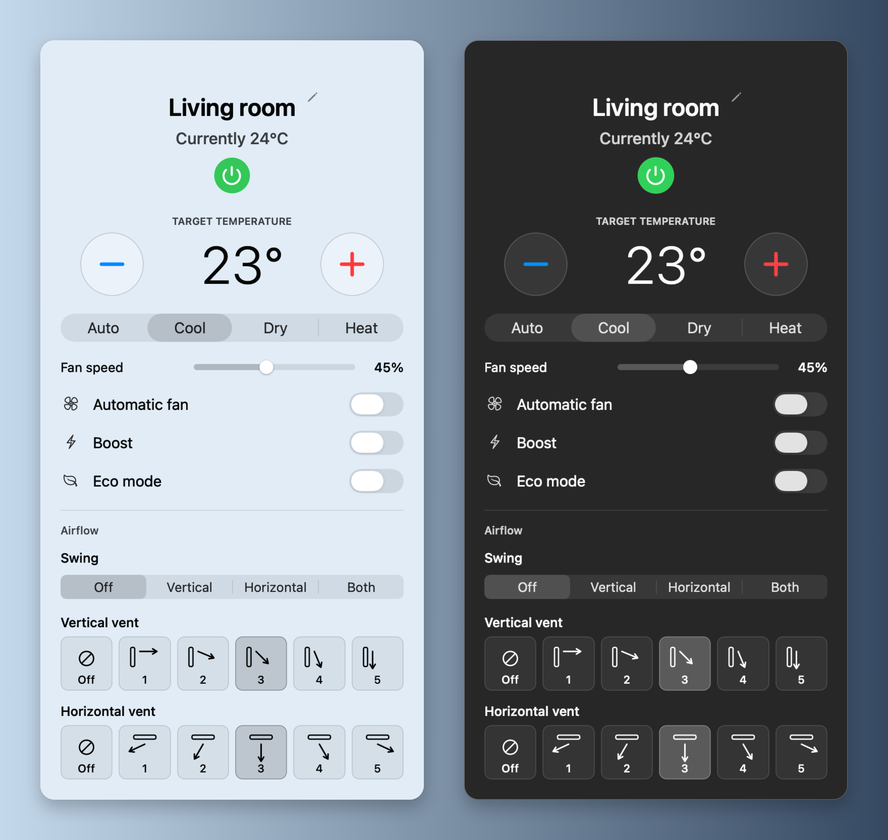

# ac-man

Control Midea air conditioners through SmartHome / MSmartHome cloud from a macOS menu-bar app or the `ac-man` command-line tool. Both interfaces use the same asynchronous Rust core; [BoltFFI](https://github.com/boltffi/boltffi) connects it directly to the native Swift interface. Python, a local web server, and Home Assistant are not required.

Sign in with your own SmartHome account. The controller discovers the air conditioners available to that account, imports their names, and assigns stable local integer IDs. There is no built-in household inventory or fixed device limit. Your computer needs internet access, but it does not need to join the ACs' Wi-Fi network. The ACs must remain online.

This is an unofficial community client. Model capabilities and SmartHome service changes can affect compatibility.

## Install

On an Apple Silicon Mac running macOS 13 or later, install **both the menu-bar app and CLI** with Homebrew:

```sh
brew trust --formula bootstrap314/tap/ac-man
brew install --cask bootstrap314/tap/ac-man
```

The first command approves the CLI dependency on Homebrew versions with tap trust enforcement. If your Homebrew does not have a `trust` command, skip that line. The cask then installs both components.

Open **ac-man** from Applications and run `ac-man` in Terminal. The cask installs the CLI formula as a dependency.

For CLI-only installation on Apple Silicon, Intel Mac, or Linux x86_64:

```sh
brew install --formula bootstrap314/tap/ac-man
```

You can also download directly from [Releases](https://github.com/bootstrap314/ac-man/releases/latest): the **DMG** contains the Mac menu-bar app with drag-to-Applications installation; the platform-specific **tar.gz** archives contain the CLI. The app and DMG are Developer ID signed and notarized. Linux CLI packages require glibc 2.36 or newer.

## Menu-bar application



Light and dark appearances, rendered from the native controls with example room data. [Light view](docs/images/ac-man-light.png) · [Dark view](docs/images/ac-man-dark.png)

Open **ac-man.app**, then click its air-conditioner icon in the menu bar. Sign in and choose a discovered AC to see its status and controls:

- Power, target temperature in Celsius, operating mode, and swing.
- Visual vertical and horizontal vent position buttons on units that advertise support, plus a segmented Swing selector.
- Fan speed as a percentage slider, with an **Automatic fan** switch.
- A **Boost** switch for the unit's turbo setting and an **Eco mode** switch on supported units.
- A local room label, shared with the CLI.

Supported controls come from the unit's capabilities. Units with custom fan control accept whole percentages from 1–100; units with fixed speeds accept only the percentages they report. The fan slider is greyed out while Automatic fan or Boost is active. Automatic fan, Boost, and Eco are mutually exclusive in the menu-bar app: turning one on clears the other two in the same request. Turning a toggle off does not activate another. Selecting Boost or Eco restores a supported manual fan setting. Commands are followed by a status read to confirm the result.

The Swift interface awaits Rust operations asynchronously. Network requests do not run on the UI thread. The current app build targets Apple Silicon Macs running macOS 13 or later; CLI release packages also support Intel Macs and Linux x86_64. Local builds are ad hoc signed. The release workflow signs the app with Developer ID, notarizes it with Apple, and staples the ticket before publishing.

## Command-line use

After building, use `target/release/ac-man`, `dist/bin/ac-man`, or place the downloaded `ac-man` executable on your `PATH`.

```sh
ac-man login
ac-man list
ac-man list --refresh
ac-man 1 status
```

`login` prompts for your SmartHome email and then reads the password without displaying it. You may supply the email as `ac-man login user@example.com`. There is deliberately no `--password` argument, so the password does not need to appear in shell history or process arguments.

For automation, `ac-man login user@example.com --password-stdin` reads one password line from standard input. Pipe it directly from your password manager or secret provider; do not type the password into the command or put it in an environment variable.

Device commands follow this structure:

```text
ac-man <assigned integer ID or room name> <command> [options]
```

For example, after checking the IDs in `ac-man list`:

```sh
ac-man 1 on
ac-man 1 temperature 23.5
ac-man 1 mode cool
ac-man 1 fan 37
ac-man 1 fan auto
ac-man 1 boost on
ac-man 1 boost off
ac-man 1 eco on
ac-man 1 eco off
ac-man 1 swing vertical
ac-man 1 vertical-angle 2
ac-man 1 horizontal-angle 3
ac-man 1 set --power on --temperature 23 --mode cool --fan auto --boost off
ac-man 1 off

ac-man 1 rename "Office"
ac-man "Office" id 7
ac-man 7 status --json
```

Labels match without regard to case; quote labels containing spaces. A label or assigned ID changes only this controller's local mapping, not the name in the phone app. IDs must be unique positive integers and survive restarts and later discovery. Use an integer ID if imported cloud names are ambiguous. Rename and ID commands work offline.

| Command | Values |
|---|---|
| `status` | Read current state and supported controls; `--json` includes capabilities |
| `on`, `off` | Power |
| `temperature` (or `temp`) | Celsius, in half-degree steps within the unit's range |
| `mode` | `auto`, `cool`, `dry`, `heat`, `fan`, `smart-dry` |
| `fan` | Whole percentage `1`–`100`, or `auto` |
| `swing` | `off`, `horizontal`, `vertical`, `both` |
| `vertical-angle`, `horizontal-angle` | `off`, or position `1`–`5` on supported units (not degrees) |
| `boost` | `on`, `off` |
| `eco` | `on`, `off` (supported units) |
| `set` | Combine `--power`, `--temperature`, `--mode`, `--fan`, `--swing`, `--boost`, `--eco`, `--vertical-angle`, `--horizontal-angle` |
| `rename` | New local label, up to 60 characters |
| `id` | New unique positive integer |

Only settings supported by the selected AC are accepted. Use `ac-man --help` or `ac-man 1 --help` for the parser's full help. `--json` is available globally. Cloud failures and invalid settings produce a nonzero exit status. If a change cannot be confirmed, refresh the device before deciding whether to repeat it.

`ac-man list` reads the local inventory without contacting the cloud; `list --refresh` fetches live state. Sign in again to refresh the cloud inventory after adding an AC. `ac-man logout` removes the saved login and cloud session from this computer's credential store.

## Credentials and local data

CLI login saves credentials and the reusable cloud session in **macOS Keychain** or the Linux user's **Secret Service** keyring. Linux login requires a running user-session D-Bus and an unlocked Secret Service implementation, such as a desktop keyring. There is no plaintext password-file fallback. The menu-bar app can also keep a sign-in only in memory when its remember option is disabled.

The app and CLI share the default application-data directory:

| Platform | Default location |
|---|---|
| macOS | `~/Library/Application Support/Midea Control` |
| Linux | `$XDG_DATA_HOME/ac-control`, or `~/.local/share/ac-control` |

This directory contains device inventory, local labels and IDs, a stable client identity, and status diagnostics. It does not contain login passwords or session tokens. Room names and device details are still private information; do not include the directory in public issues or source archives. New Unix data files use owner-only permissions.

Use `--data-dir PATH` for the CLI, or `AC_MAN_DATA_DIR` for either interface, to select another private data directory. Use the same directory for both interfaces when sharing labels and IDs. This changes the data location; it does not create a separate OS credential-store account. `AC_CONTROL_DATA_DIR` remains a fallback for existing installations. The default storage paths and credential identifiers retain their historical names so existing sessions and room labels keep working.

See [SECURITY.md](SECURITY.md) for reporting, network boundaries, credential handling, and release safeguards.

## Build from source

The repository pins **Rust 1.98.1** in `rust-toolchain.toml` and **BoltFFI 0.30.1** in `Cargo.toml`. Commit `Cargo.lock` and use the locked dependency graph.

For the CLI, install Rust through `rustup` and the platform's C build tools. On macOS, install Xcode Command Line Tools. Linux needs a C compiler, linker, `make`, and `pkg-config`; the D-Bus dependency is built from vendored source.

```sh
rustup toolchain install 1.98.1 --profile minimal --component rustfmt --component clippy
make cli
./target/release/ac-man --help
```

For the Apple Silicon menu-bar app, also install the pinned BoltFFI generator and use Xcode Command Line Tools with Swift 5.9 or newer:

```sh
cargo install boltffi_cli --version 0.30.1 --locked
make app
open "dist/ac-man.app"
```

`build.sh` generates the Apple bindings in `generated/apple`, builds the Swift package from `native/AcMan.swift`, and produces `dist/ac-man.app` and `dist/bin/ac-man`. The app loads the Rust core directly through the generated bindings.

The principal source files are:

| Path | Responsibility |
|---|---|
| `src/cloud.rs` | SmartHome authentication, account inventory, and cloud relay |
| `src/protocol.rs` | AC capabilities, state decoding, and command encoding |
| `src/controller.rs` | Async operations, command validation, and readback |
| `src/storage.rs` | Local IDs, labels, file locking, and OS credential storage |
| `src/cli.rs` | Device-first command syntax and hidden password entry |
| `native/AcMan.swift` | Native menu-bar interface |
| `boltffi.toml` | Rust-to-Swift binding configuration |

## Checks and dependency notices

```sh
make ci                 # formatting, Clippy, and Rust tests
make cli                # locked release build
cargo install cargo-audit --version 0.22.2 --locked
make audit              # RustSec advisories, including CVEs
make trivy              # requires Trivy; source/dependency/secret/configuration scan
make security           # Cargo Audit and Trivy
```

CI uses checksum-pinned Trivy **0.76.0**. Trivy fails on HIGH or CRITICAL findings, including unfixed vulnerabilities; Cargo Audit fails on vulnerability advisories in the locked Rust dependencies. Tests use synthetic fixtures and do not need a SmartHome account. A passing fixture test does not establish compatibility with every AC model.

Generate dependency-license notices before distributing binaries:

```sh
cargo install cargo-about --version 0.9.1 --locked --features cli
make licenses
```

`licenses/DEPENDENCIES.html` is generated from the locked dependency graph. Release packaging requires it and includes [THIRD_PARTY_NOTICES.md](THIRD_PARTY_NOTICES.md). See that document for protocol references, license texts, and target-specific notice generation.

## Docker CLI build

Docker provides a pinned Linux build environment. Exporting the CLI is the primary container workflow:

```sh
make docker-test
make docker-export
```

The exported Linux executable is `dist/docker/ac-man`. The x86_64 release is built on Debian 12 and requires glibc 2.36 or newer. Docker builds use the builder's platform; use a Linux x86_64 builder when producing that release target.

An optional runtime image runs as a non-root user and contains dependency notices:

```sh
make docker-build
docker run --rm --read-only --cap-drop ALL --security-opt no-new-privileges ac-man:local --help
make trivy-image
```

The runtime does not start a desktop keyring or D-Bus service, so it is mainly useful for help and local operations. Use the exported CLI in your Linux user session for normal saved-login operation. Never put account credentials in an image or its build arguments.

## GitHub Actions and manual releases

**Tests and security** runs on pull requests and pushes to main, and can also be started manually. It checks Rust formatting, Clippy, tests, CLI builds on Linux x86_64 and macOS arm64/Intel, the Apple Silicon Swift app build, Cargo Audit, Trivy source scans, and the built runtime image. The workflow also serves as the release verification gate.

Native macOS control tests (no AC commands): `make test-native`.

Trivy source and container scans publish separate SARIF analyses to GitHub **Security → Code scanning** for main and same-repository PRs. Reports are also saved as workflow artifacts, including fork PRs and release checks. High/Critical findings still fail CI; RustSec checks run with `cargo audit`. Trivy covers dependencies, secrets, and configuration rather than general application-code data-flow analysis.

**Release selected tag** runs only through `workflow_dispatch`; pushing a tag does not publish a release. First follow the [macOS signing setup](docs/macos-release.md) to configure the `macos-release` GitHub environment with your Apple certificate and notarization credentials. The workflow refuses to publish if signing or notarization fails. To release:

1. Commit the intended source and lockfile, create a signed annotated tag such as `v0.0.1` with the feature notes in its message, and push that tag to GitHub.
2. Open **Actions → Release selected tag → Run workflow** and supply the existing tag in the `tag` field. Use letters, digits, dots, underscores, or hyphens; start with a letter or digit.
3. The workflow resolves that tag to a commit and runs the tests and security gates on it. The macOS verification job builds the app once and saves its unsigned archive. A separate macOS job consumes that same archive, signs and notarizes the app, attaches Apple's ticket, and verifies it with Gatekeeper. Publishing fails if any of those steps fail or the tag moves during the run.

The release notes come from the signed tag annotation. The release contains CLI archives for macOS arm64, macOS Intel, and Linux x86_64, plus the signed and notarized Apple Silicon app installer (`ac-man-app-<tag>-macos-apple-silicon.dmg`), `SHA256SUMS`, and `SOURCE.txt` with the tag, commit, and workflow-run link. Recipients open the DMG, drag the app onto its Applications shortcut, and sign in to their own SmartHome account; they do not need Rust or Swift installed. The separate CLI archives do not go through the app-signing job. Existing releases are not overwritten. Downloads include generated dependency notices; account data is never a packaging input.

All workflow actions use immutable commit pins, and checkout credentials are not retained. Only the final publishing job has release-write permission. Configure branch protection and tag protection in the GitHub repository; workflow files do not enable those repository settings.

## License

ac-man is licensed under the [Apache License 2.0](LICENSE). Third-party components retain their own licenses; see [THIRD_PARTY_NOTICES.md](THIRD_PARTY_NOTICES.md) and the generated `licenses/DEPENDENCIES.html` included with release downloads.
