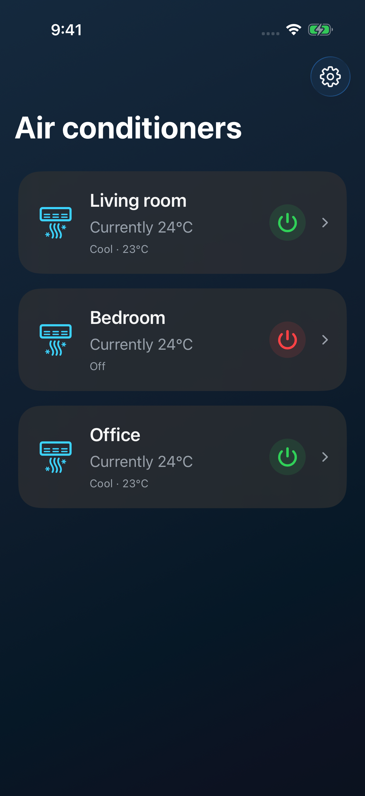
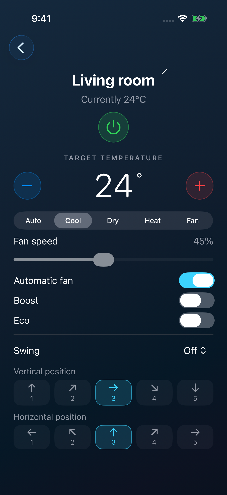
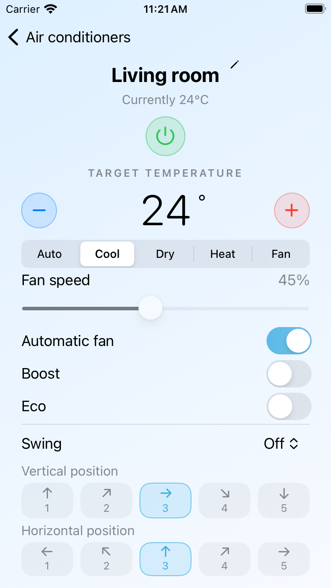

# iPhone app

The iOS 17+ SwiftUI app uses the same Rust cloud client and BoltFFI bindings as the Mac app. Devices are discovered from the signed-in SmartHome account. Credentials are stored in the app's Keychain; labels and account state stay in its sandbox.

## Build and run

On an Apple Silicon Mac, install Xcode with an iOS simulator, XcodeGen (`brew install xcodegen`), and BoltFFI 0.30.1. Use the repository's pinned Rust toolchain.

```sh
./scripts/build-ios.sh
open ios/AcMan.xcodeproj
```

Choose the AcManIOS scheme and an iPhone simulator in Xcode. The Xcode project and Rust frameworks are generated; `project.yml` is the source of truth. This build does not alter the Mac release artifacts.

For UI previews without an account, add `--demo` to the scheme's launch arguments in a Debug build. Sample devices exist only in memory and never send cloud commands. Release builds ignore the argument.

```sh
IOS_DESTINATION='platform=iOS Simulator,name=iPhone 17 Pro' ./scripts/build-ios.sh test
```

Tests cover change coalescing, exclusive presets, special fan values, login validation, navigation, temperature changes, and vent selection. UI tests use sample devices; real cloud login and hardware behavior require a separate check with your account.

To run on a physical iPhone, open the project, select your Apple development team in Signing & Capabilities, use a unique bundle identifier if necessary, and select the connected phone. Simulator builds use local ad-hoc signing so Keychain access works; Xcode handles development signing for a physical device. The official iPhone and Mac bundle identifier is `com.infovore-labs.acman`. Forks should use their own identifier and signing team.

The UI follows system light/dark appearance, adapts to the available screen height, and only shows vent controls advertised by the shared core. A selected vent position remains highlighted when a device omits its angle in a subsequent response; that is the last requested position, not confirmed telemetry.

## Simulator screenshots

Actual iPhone 17 Pro simulator captures using in-memory sample devices:

 

The layout sizes itself from the available screen height, with tighter gaps on compact phones. Verified on iPhone 17 Pro (iOS 26.5, dark) and iPhone SE 3rd generation (iOS 17.5, light), including the full final vent row without scrolling at the default text size. Scrolling remains available for larger text, long names, and device-specific extra controls.



## TestFlight archives

Open `ios/AcMan.xcodeproj`, select the AcManIOS scheme, your development team, and a generic iOS device destination. Choose Product → Archive, then Distribute App → App Store Connect in Organizer. Increment the build number for each upload. The app icon must have no alpha channel.

The official app record uses `com.infovore-labs.acman`. Internal testing builds are selected manually in App Store Connect after processing and any required export compliance review. Signing certificates and provisioning profiles stay outside this repository.
